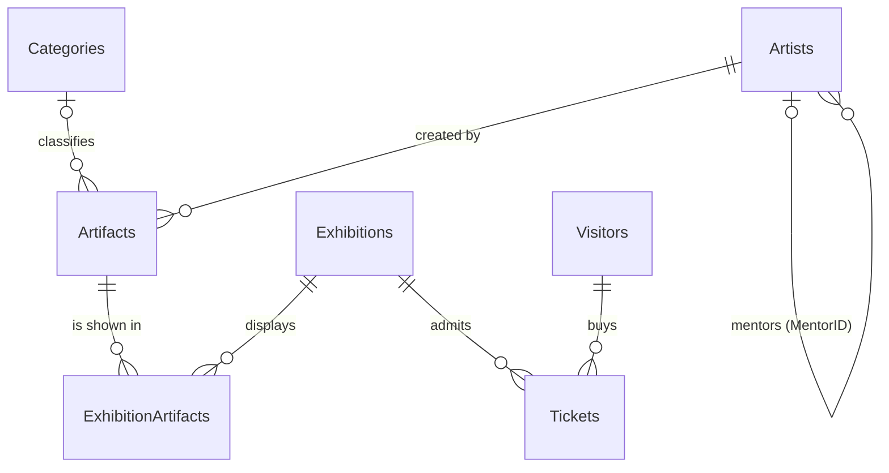

# Museum Database (PostgreSQL)

A relational database for a museum: artists, categories, artifacts, exhibitions, visitors and ticket sales.
Built as a university Databases course project and worked through in stages, from requirements and ER design
to constraints, queries, views, indexing and query-plan analysis.

**Stack:** PostgreSQL 16 · plain SQL · Docker (optional)

## Entity-relationship diagram




- **One-to-many:** artist → artifacts, category → artifacts, visitor → tickets, exhibition → tickets.
- **Many-to-many:** exhibitions ↔ artifacts, resolved by the junction table `ExhibitionArtifacts`
  (`UNIQUE (ExhibitionID, ArtifactID)` prevents listing the same artifact twice in one exhibition).
- **Self-reference:** `Artists.MentorID` points to another artist (used for the SELF JOIN examples).

## Quick start

With Docker (schema and sample data load automatically on first start):

```bash
docker compose up -d
docker compose exec db psql -U museum -d museum -f /sql/07_aggregates_subqueries.sql
```

With an existing PostgreSQL server:

```bash
createdb museum
psql -d museum -f sql/run_all.sql      # runs everything in order, stops at the first error
```

`run_all.sql` can be run repeatedly: `01_schema.sql` drops and recreates everything, so each run starts from a clean database.
`02_seed.sql` on its own is not repeatable (it would insert the same rows again); run `01_schema.sql` first to reset.

## What is in `sql/`

| File | Content |
|---|---|
| `01_schema.sql` | 7 tables, primary/foreign keys, `ON DELETE` / `ON UPDATE` actions, `NOT NULL`, `UNIQUE`, `CHECK`, `DEFAULT` |
| `02_seed.sql` | Sample data (fictional): 13 artists, 11 categories, 25 artifacts, 10 exhibitions, 17 visitors, 46 tickets |
| `03_dml_exercises.sql` | `UPDATE` (unique / range / logic / NULL) and `DELETE` (single / bulk / dependent) exercises, wrapped in a transaction that is **rolled back** |
| `04_select_basics.sql` | `SELECT`, `WHERE`, `DISTINCT`, `ORDER BY`, `LIMIT` |
| `05_joins.sql` | `INNER`, `LEFT`, `RIGHT`, `FULL OUTER` and self joins |
| `06_operators.sql` | `AND` / `OR` / `NOT`, `BETWEEN`, `LIKE` / `ILIKE`, `IN`, `EXISTS`, `IS NULL`, combined with joins |
| `07_aggregates_subqueries.sql` | `SUM` / `AVG` / `COUNT` / `MIN` / `MAX`, `GROUP BY` / `HAVING`, subqueries in `WHERE`, `SELECT` and `FROM` |
| `08_views.sql` | 5 views (aggregation, 3-table join, date/state filter, top-N, subquery in `FROM`) |
| `09_indexes_explain.sql` | 5 index types, `EXPLAIN` / `EXPLAIN ANALYZE` before and after, on a generated 200 000-row table |
| `10_metadata.sql` | Querying `information_schema.tables`, `information_schema.columns` and `pg_indexes` |
| `run_all.sql` | Runs everything in order |

## Design decisions

| Relationship | Action | Why |
|---|---|---|
| Artifacts → Artists, Categories | `ON DELETE RESTRICT` | An artist or category that still has artifacts must not disappear |
| Tickets → Visitors, Exhibitions | `ON DELETE RESTRICT` | Sold tickets are financial records |
| ExhibitionArtifacts → Exhibitions, Artifacts | `ON DELETE CASCADE` | A link row is meaningless once either side is gone |
| All foreign keys | `ON UPDATE CASCADE` | Key changes propagate (the self-reference `MentorID` keeps the default) |

Other choices: `Artifacts.CategoryID` is nullable (an artifact can be catalogued before it is categorised),
`Price` must be positive, an exhibition's `EndDate` and a display's end date cannot precede their start dates,
and visitor e-mails are unique.

## Example: business questions the data answers

```sql
-- Revenue and tickets sold per exhibition (view in 08_views.sql)
SELECT Exhibition, TicketCount, TotalRevenue
FROM v_exhibition_revenue
ORDER BY TotalRevenue DESC;
```

| exhibition | ticketcount | totalrevenue |
|---|---|---|
| Women in European Art | 8 | 1000.00 |
| Modern Art | 6 | 935.00 |
| European Masters | 6 | 770.00 |
| Sculpture Through Time | 5 | 675.00 |

Other examples in the repo: each exhibition's share of total revenue, artists with no artifacts, exhibitions with
no tickets sold, visitors who never bought a ticket, tickets priced above the average, categories that have no artifacts.

## Example: effect of an index

`09_indexes_explain.sql` runs the same lookup on a 200 000-row table before and after `CREATE INDEX`:

```sql
EXPLAIN ANALYZE SELECT * FROM tickets_test WHERE visitdate = DATE '2025-06-15';
```

| | Plan node | Execution time (one run) |
|---|---|---|
| Without index | Seq Scan (199 807 rows read and discarded) | 7.1 ms |
| With index | Bitmap Index Scan on `idx_tickets_test_visitdate` | 0.14 ms |

The table is filled with random data and timings depend on the machine, so treat the plan node and the order of
magnitude as the result, not the exact numbers. On the real tables (about 46 tickets) PostgreSQL correctly keeps
using a Seq Scan, which is why the comparison uses the larger table.

## Notes

- All people, e-mail addresses and phone numbers are fictional. The mentor links between artists are illustrative, not historical claims.
- Identifiers are written in CamelCase but are unquoted, so PostgreSQL stores them in lower case (`artists`, `artistid`).
  Queries against `information_schema` therefore use lower-case names.
- Tested on PostgreSQL 16.
- Not enforced by the schema: that a ticket's `VisitDate` falls inside its exhibition's dates and is not before `PurchaseDate`.
  The sample data satisfies both rules; enforcing them for new rows would need a `CHECK` on `PurchaseDate <= VisitDate`
  and a trigger for the exhibition window.
